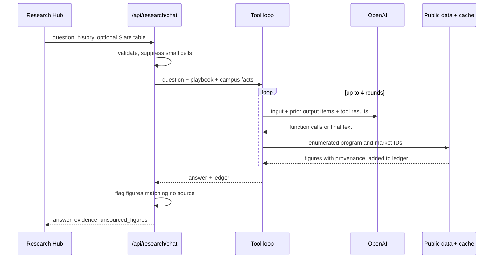

# feat: Research Hub nursing advisor with sourced market evidence

## Summary

Give the Research Hub a nursing-only advisor that answers budget and marketing decisions with public data, optional Slate aggregates, and a written decision playbook. The test question is "in my budget people are proposing a subway ad in NYC for the nursing program." The answer must name who the ad could actually reach, cite sourced numbers, give a verdict, and propose a cheaper test.

---

## Problem Frame

An enrollment leader at SUNY Delhi wants AVP-level strategic help that compiles geographic, labor, and marketing context. The Research Hub today sends one prompt to OpenAI with campus facts and no live data (`server/openai.js`), and BLS and Census appear only as links (`server/routes/data.js`). It therefore gives plausible general marketing advice.

The subway question shows what generic advice misses. "Nursing" at Delhi is several products:

- The campus AAS and the dual degree are taught in Delhi, NY.
- RN-to-BSN and MSN are online and require an RN license.

A subway ad reaches a different audience for each, and only some of those riders can enroll. The NYC metro has 197,740 employed RNs (BLS, 2025), but that is a universe, not an audience. New York's BSN in 10 law exempts anyone licensed on or before June 18, 2020, and its earliest deadline is June 19, 2030. Delhi also already runs an online nursing landing page, so a cheaper digital test is possible.

---

## Requirements

**Advice quality**

- R1. Before judging a proposal, the advisor names which offering and audience it would actually reach.
- R2. Every budget answer gives a verdict (buy, test first, or don't), a condition that would change it, and a cheaper test where one exists.
- R3. The advisor separates a market's total population from its addressable audience.
- R4. The advisor lists what it could not verify and asks for missing inputs, and it never invents ad rates, tuition, or program facts.

**Evidence**

- R5. The UI shows source, period, geography, and retrieval date for each public figure, from a server record rather than the model's text.
- R6. Figures in an answer that match no supplied source are flagged to the reader.
- R7. When a source fails, the advisor uses a cached value marked stale or says the data is unavailable, and still answers.

**Slate**

- R8. Slate aggregates reach the model only when the user attaches a fetched table to one question, are not stored by the attach flow, and are disabled until Delhi approves.

**Scope and continuity**

- R9. Other Research Hub questions keep working, and unmapped programs or markets are reported as unmapped rather than guessed.
- R10. Sources travel with an answer when it is saved to notes or sent through "Use This."

---

## Scope Boundaries

- Nursing only, and only the markets seeded in U1.
- No new dashboard screen or charts.
- No ad account connections (GA4, Google Ads, Meta). These stay outside the app.
- No scraping and no live job postings.

### Deferred to Follow-Up Work

- O*NET and College Scorecard. Neither changes the subway verdict, and O*NET requires a reviewed project registration.
- Additional programs, which become config entries once nursing proves useful.
- An MCP endpoint exposing these tools to Claude or Copilot.
- Lightcast job postings, if Delhi already holds a license.

---

## Acceptance Examples

- AE1. Subway ad, no quote or Slate supplied
  - **Given:** "In my budget people are proposing a subway ad in NYC for the nursing program."
  - **Then:** The answer splits campus programs from online RN programs and judges each. It cites NYC RN employment as a universe and qualifies it using BSN in 10. It gives a verdict and a cheaper test tied to a measurable result. It asks for the media quote and states that Delhi's own NYC pipeline was not available.
- AE2. Slate attached
  - **Given:** The same question with a fetched aggregate table attached.
  - **Then:** The answer uses NYC inquiry and conversion counts, counts of 1 to 4 appear as "<5", and the next question does not resend the table.
- AE3. Quote supplied
  - **Given:** "The quote is $60,000 for four weeks."
  - **Then:** The answer shows the enrollments needed to break even, and labels any tuition input with its source or asks for it.
- AE4. Source outage
  - **Given:** BLS fails and a cached value exists.
  - **Then:** The answer uses the value, and the source list marks it stale with its original retrieval date.
- AE5. Unmapped request
  - **Given:** A question about a billboard for welding in Buffalo.
  - **Then:** The answer says welding and Buffalo have no mapped data, gives general reasoning labeled as such, and shows no fabricated figures.

---

## Key Technical Decisions

- **Function tools, not MCP or a fixed evidence pack:** The app is the only consumer, so MCP adds a hop with no benefit. Tools let the model pick the market a question names, which a fixed pack cannot do.
- **Enumerated tool parameters only:** The model chooses a program ID and market ID from seeded lists, and the server builds every URL and series ID. This removes SSRF risk and stops the model from querying the wrong occupation.
- **Server-side evidence ledger:** Tool results are recorded as the model requests them, and the ledger is what the UI renders. Citations the model writes are not trusted.
- **New cache table, not `data_snapshots`:** That table's `kind` CHECK allows only `slate` and `suny_enrollment`, and SQLite would need a table rebuild to widen it. Its `data_points` columns are also shaped for funnels, while cached API responses are JSON blobs with provenance.
- **Five sources for this slice:** BLS OEWS, NY DOL projections, Census ACS, IPEDS through the Urban Institute API, and SUNY first-time undergraduates by county. Each one feeds a part of the subway verdict.
- **NY DOL as seeded rows:** It publishes workbooks every other year with no API found. Extracting nursing rows into config avoids a new xlsx dependency.
- **Playbook, not model training:** "Trained" means a decision framework in the instructions, seeded program facts, and an eval set.
- **Keep `store: false`:** The tool loop stays stateless by requesting encrypted reasoning and passing output items back each round.
- **Slate gate off by default:** Sending aggregates to OpenAI needs Delhi's approval, so an env flag controls the attach control. Small cells are suppressed because low counts can identify people.
- **Eval script outside `npm test`:** The suite stays offline, while advice quality can only be judged against the live model and data.

---

## High-Level Technical Design

| Tool | Returns | Source | Key |
|---|---|---|---|
| `get_program_profile` | Offerings, modality, licensure needs, official URLs, verified date | Seeded config | None |
| `get_labor_market` | RN employment and median wage, projected openings | BLS OEWS, NY DOL seed | Optional BLS |
| `get_market_profile` | Population, age, attainment, first-time SUNY students by county | Census ACS, data.ny.gov | Census |
| `get_competitors` | Nursing completions by institution and award level | Urban Institute IPEDS | None |

---

## Implementation Units

### U1. Seed nursing and market reference data

- **Goal:** Provide the verified lookup data every tool depends on.
- **Requirements:** R1, R4, R9
- **Dependencies:** None
- **Files:** `config/content.json`, `test/config.test.js`
- **Approach:**
  - Add an `advisor` section with a `nursing` program and markets for `nyc`, `southern_tier`, `capital`, `hudson_valley`, and `statewide`.
  - Each offering records modality, location, licensure requirement, start pattern, official URL, and `verified_at`.
  - Each market records its OEWS area code, county FIPS list, NY DOL region, and a note on geography mismatch.
  - Include the BSN in 10 rule with its NYSED URL, and NY DOL rows for SOC 29-1141 in each seeded region.
  - Reverify offerings and online tuition against current delhi.edu pages, because some online pages show old dates.
- **Patterns to follow:** The `audienceLanes` and `enrollmentMoments` structure in `config/content.json`.
- **Test scenarios:**
  - Happy path: the shipped config has a nursing program with campus and online offerings, each with a URL and `verified_at`.
  - Edge case: every market has an OEWS area, at least one county FIPS (except `statewide`), and a NY DOL region.
  - Error path: an offering missing `verified_at` fails the config test.
- **Verification:** Every fact in the seed traces to a dated official page.

### U2. Public data clients and cache

- **Goal:** Fetch each source once, cache it, and return figures with provenance.
- **Requirements:** R5, R7, R9
- **Dependencies:** U1
- **Files:** `server/public-data.js` (new), `server/db.js`, `server/config.js`, `test/public-data.test.js` (new)
- **Approach:**
  - Add a cache table keyed by request, holding payload, source, period, and retrieval time, with a 7-day TTL.
  - Use the BLS v2 API when `EDMISSIONS_BLS_KEY` is set and v1 otherwise.
  - On fetch failure, return the cached value marked stale, or a structured "unavailable" result.
  - Inject `fetch` so tests stay offline.
  - Keep API keys out of cache keys, stored payloads, logs, and error text, since Census and BLS can carry them in requests.
  - Each tool's output carries label, value, geography, period, publisher, URL, and stale status.
  - Handle the verified API quirks listed under Sources & Research.
- **Patterns to follow:** `refreshSunyEnrollment` in `server/routes/data.js` for freshness and stale fallback; `readLimitedText` for response size limits; `AbortSignal.timeout` on every call.
- **Test scenarios:**
  - Happy path: a mocked BLS response for NYC RNs yields employment 197,740 and median $119,720, labeled 2025 and NYC metro.
  - Happy path: a second call inside the TTL makes no network request.
  - Edge case: BLS "No Data Available" messages for older years do not hide the available year.
  - Error path: a failed refresh with a cached row returns the old value marked stale with its original date. Covers AE4.
  - Error path: a failed fetch with no cache returns "unavailable" and no number.
  - Error path: an unmapped program or market returns "unmapped" without any network call. Covers AE5.
  - Error path: a missing Census key returns "unavailable" and does not throw.
  - Error path: a failed call with a configured key produces no output, cache row, or error containing that key.
- **Verification:** Each tool returns provenance-complete output against mocked payloads captured from the real APIs.

### U3. Tool loop and decision playbook

- **Goal:** Let the model gather evidence and answer using the playbook.
- **Requirements:** R1, R2, R3, R4, R5, R7
- **Dependencies:** U2
- **Files:** `server/openai.js`, `server/index.js`, `test/openai.test.js`
- **Approach:**
  - `createAi` receives the tool set from `server/index.js`, which already holds both the database and config.
  - Extend `researchAnswer` to run a function-tool loop with a limit of 4 rounds, a 150-second deadline, and encrypted reasoning passed back each round.
  - Return the answer and evidence ledger together.
  - On the round limit, force a final answer with no further tools.
  - Raise the output ceiling, and treat an incomplete response as an error rather than returning partial text.
  - The playbook requires this order: verdict, who this actually reaches by offering, evidence, unknowns and needed inputs, break-even if a cost is known, cheaper test, and what would change the verdict.
  - The playbook requires tool data for any public figure, quoted exactly rather than rounded, so the figure check can match it.
  - The playbook treats tool output as data rather than instructions, and tells the model that total counts are universes.
  - Keep existing plain-text behavior and campus-fact rules for general questions.
- **Patterns to follow:** The injected client in `createAi` and `test/openai.test.js`; the existing "use only the supplied campus knowledge" language.
- **Execution note:** Implement the loop test-first with a scripted fake client.
- **Test scenarios:**
  - Happy path: a scripted function call then final text returns the answer with a one-item ledger, and tool output is sent back with the matching call ID.
  - Happy path: every request has `store: false` and requests encrypted reasoning, and prior output items are included on later rounds.
  - Edge case: a general question with no tool calls behaves as it does today.
  - Edge case: two calls in one round both execute and both reach the ledger.
  - Error path: a model that never stops calling tools is cut off at 4 rounds and forced to answer.
  - Error path: a tool call with an invalid argument or unknown tool name returns a structured error to the model and does not throw.
  - Error path: an incomplete response raises an error the route converts to its existing 502.
- **Verification:** The fake-client tests pass, and instructions include the seven playbook sections.

### U4. Route, Slate attachment, and figure check

- **Goal:** Expose the advisor through the existing endpoint, including gated Slate input.
- **Requirements:** R5, R6, R8, R9
- **Dependencies:** U3
- **Files:** `server/routes/ai.js`, `server/routes/data.js`, `server/config.js`, `server/index.js`, `test/gating.test.js`, `test/data.test.js`
- **Approach:**
  - `/api/research/chat` returns `answer`, `evidence`, and `unsourced_figures`.
  - Add `EDMISSIONS_SLATE_AI_APPROVED`, default off, and expose it through `/api/capabilities`.
  - Reject an attached table when the flag is off.
  - Export the aggregate validators from `server/routes/data.js` and revalidate attachments with them.
  - Cap attachments at 300 rows to bound token cost across rounds, then replace `count` and `prior_year_count` values of 1 to 4 with "<5" before prompting.
  - Delimit the table as data in the prompt, and do not write it to the database.
  - The figure check extracts dollar amounts, percentages, and numbers of three or more digits, ignoring years from 1900 to 2100.
  - It compares them with the ledger, question, conversation history, campus facts, program profile, and Slate table.
  - Raise the history answer limit from 10,000 characters so longer advisor answers do not break follow-up questions.
  - Mark the check's ceiling with a `ponytail:` comment, since derived arithmetic will also be flagged.
- **Patterns to follow:** `validateAggregateRows` and `assertAggregateColumns` in `server/routes/data.js`; `guard` and input limits in `server/routes/ai.js`; metadata-only `logAiError`.
- **Test scenarios:**
  - Happy path: the response includes the answer and ledger, and existing callers still get `answer`.
  - Covers AE2: a valid table with counts 3 and 40 reaches the AI as "<5" and 40, and nothing is added to `data_snapshots` or `data_points`.
  - Edge case: a count of 0 remains 0, and a cell of 4 in `prior_year_count` is suppressed.
  - Error path: an attachment with the flag off returns 403, and the AI is not called.
  - Error path: a table with an `email` column or more than 300 rows returns 400, and the AI is not called.
  - Happy path: a figure in the ledger is not flagged, and "$9,999" with no source is flagged.
  - Edge case: "197,740" in the answer matches a ledger value of 197740.
  - Edge case: "2025" in the answer is not flagged.
  - Edge case: a follow-up answer repeating a figure from a prior exchange is not flagged.
  - Edge case: a follow-up carrying a prior answer over 10,000 characters is accepted.
- **Verification:** Gating tests prove no unapproved or person-level Slate data reaches the AI client.

### U5. Research Hub sources and attachment UI

- **Goal:** Show evidence with each answer and offer the attachment when allowed.
- **Requirements:** R5, R6, R8, R10
- **Dependencies:** U4
- **Files:** `public/js/notes.js`, `public/js/data.js`, `public/js/source-context.js`, `public/js/research-chat-state.js`, `public/css/app.css`, `test/research-chat-state.test.js`, `test/source-context.test.js`
- **Approach:**
  - Under each answer, render a Sources list with label, value, geography, period, publisher link, retrieval date, and a stale marker.
  - Render flagged figures separately as "Not from a source; may be the advisor's arithmetic. Verify before using."
  - `public/js/data.js` exports read access to the current fetched table.
  - When the capability is on and a table exists, show an unchecked "Attach Slate table (N rows) to this question" control that resets after each send.
  - State that the table goes to OpenAI.
  - Change the busy status to say an answer can take a couple of minutes.
  - Saved notes and `normalizeResearchSource` include a plain-text Sources block.
  - `normalizeSourceContext` rejects excerpts over 4,000 characters, so `normalizeResearchSource` trims the answer to fit and always keeps the Sources block. The verdict comes first, so it survives trimming.
- **Patterns to follow:** The `el()` helpers and status messaging in `public/js/notes.js`; existing `.chat-response` and `.muted` styles; `sourceBody` in `public/js/source-context.js`.
- **Test scenarios:**
  - Happy path: `addResponse` keeps evidence and flagged figures on the chat item.
  - Happy path: `normalizeResearchSource` output includes each source's publisher, period, and URL. Covers R10.
  - Edge case: a 9,000-character answer produces an excerpt within 4,000 characters that starts with the verdict and ends with the complete Sources block, and "Use This" saves it without an error.
  - Edge case: `recentResearchHistory` excludes evidence and any Slate table from follow-up requests. Covers AE2.
  - Edge case: an answer with an empty ledger renders no Sources heading.
  - Integration: in the running app, ask a mapped question, save it, and confirm the note holds the Sources block.
  - Integration: the attach control is absent with the flag off and resets after a send with the flag on.
- **Verification:** The subway answer renders sources in the preview without console errors, and is usable at phone width.

### U6. Advice eval and operating docs

- **Goal:** Judge the advice itself against real data, and document setup.
- **Requirements:** R1, R2, R3, R4
- **Dependencies:** U3, U4
- **Files:** `scripts/advisor-eval.mjs` (new), `README.md`, `.env.example`, `BACKLOG.md`
- **Approach:**
  - The script runs AE1, AE3, AE5, and two contrast cases against the live model and prints each answer with its ledger.
  - The contrast cases are a regional campaign for the campus AAS and an online-only campaign for RN-to-BSN, where the verdict should differ from the subway answer.
  - It automatically checks that expected tools ran and required sections exist, and it prints flagged figures.
  - A person reads the output for judgment and flagged figures, with the AE1 outcomes as the rubric.
  - Add real questions from the Delhi user to the script as they arrive.
  - Document the new keys, the Slate approval flag, and a longer proxy timeout in the nginx snippet.
  - Update `BACKLOG.md` to show Program Opportunity's first slice in progress.
- **Patterns to follow:** `scripts/dev.mjs` for script conventions; the env comment style in `.env.example`.
- **Test expectation:** none -- this unit is a manual eval script and docs; automated logic is covered in U2 to U4.
- **Verification:** The owner and the Delhi user read the subway answer and agree it is what an AVP could act on.

---

## System-Wide Impact

- **Data privacy:** Slate aggregates can now reach OpenAI when attached. An answer can also repeat those numbers, and saving it stores them in a note.
- **Request duration:** Research answers will take longer because of multiple reasoning rounds and API calls.
- **Cost:** Each advisor question makes multiple high-effort model calls, which is acceptable for one main user.
- **Unchanged:** Campaign generation, note summaries, the Data panel, and the existing Slate fetch flow.

---

## Risks & Dependencies

| Risk or dependency | Mitigation |
|---|---|
| Delhi has not approved sending aggregates to OpenAI | Flag stays off, and the advisor works on public data and states the gap |
| The deployed nginx default can cut requests at 60 seconds | Set `proxy_read_timeout` to 180 seconds on the live proxy before rollout, above the 150-second server deadline |
| `gpt-5.6-luna` tool or encrypted-reasoning behavior differs from docs | Confirm with one live call at the start of U3 |
| The figure check flags legitimate arithmetic | Wording tells the reader it may be arithmetic, and the check never blocks an answer |
| Geography mismatches mislead (OEWS NYC metro includes NJ; rural counties have no county-level OEWS) | Market notes in config are returned with every figure |
| Seeded program facts go stale | `verified_at` is shown to the model, and online tuition is confirmed in U1 |
| Carnegie may have an IP interest in enrollment tools the owner builds | Owner confirms before this expands beyond the gift |

---

## Open Questions

### Deferred to Implementation

- The exact ACS variables for age and attainment, and whether Census requires a key. A keyless probe returned HTTP 302, so plan on a free key.
- How to restrict IPEDS results to NYC, likely through the IPEDS directory endpoint's county field.
- The Delhi-approved small-cell rule. Use a threshold of 5 unless Delhi specifies otherwise. Totals can still reveal a suppressed cell, so put that limit in front of Delhi when requesting approval.
- The Southern Tier mapping for Delaware County, to confirm against NY DOL's region definitions.

---

## Sources & Research

Probed live on 2026-11-05:

- **BLS OEWS:** Keyless v1 works. Series `OEUM003562000000029114101` gave 197,740 employed RNs and `...113` gave a $119,720 median for 2025. Older years return "No Data Available" messages alongside valid data. Datatype codes are in [oe.datatype](https://download.bls.gov/pub/time.series/oe/oe.datatype). [API limits](https://www.bls.gov/bls/api_features.htm) may be dated.
- **Urban Institute IPEDS:** `completions-cip-6/2023` works with `cipcode_6digit=513801&fips=36&race=99&sex=99&majornum=1`. Filtering on `cipcode` is silently ignored and returns 580,560 rows. Year 2024 returned HTTP 500, so treat 2023 as latest.
- **SUNY origins:** [`d83q-xbce`](https://data.ny.gov/resource/d83q-xbce.json) gives first-time undergraduates by county through Fall 2025, but by sector only. Kings County sent 257 to technology colleges. Delhi-specific origin comes only from Slate, which is why the attachment matters.
- **NY DOL:** The [regional projections](https://dol.ny.gov/statistics-regional-long-term-occupational-projections) URL serves a workbook with a sheet for each of 10 regions, including New York City and Southern Tier, and includes Registered Nurses. No API found on the [projections page](https://dol.ny.gov/employment-projections).

Reference pages:

- **Delhi nursing:** [AAS](https://www.delhi.edu/academics/majors-programs/associates/nursing/index.php), [dual degree](https://www.delhi.edu/academics/majors-programs/bachelors/nursing-dual-degree/index.php), and the [online landing page](https://www.delhi.edu/digitalads/nursing-online/).
- **BSN in 10:** [NYSED guidance](https://www.op.nysed.gov/professions/registered-professional-nursing/new-york-state-bsn-in-10-law).
- **Subway pricing:** Outfront sells MTA inventory, and [third-party estimates](https://www.adquick.com/answers/transit-advertising/how-much-do-nyc-subway-ads-cost) conflict, so the advisor asks for a quote instead of seeding rates.
- **OpenAI stateless tool loop:** [Reasoning items cookbook](https://cookbook.openai.com/examples/responses_api/reasoning_items). Confirm against the current reference.
- **Prior decisions:** `BACKLOG.md` (Data Command Center and aggregate-only Slate rules).
